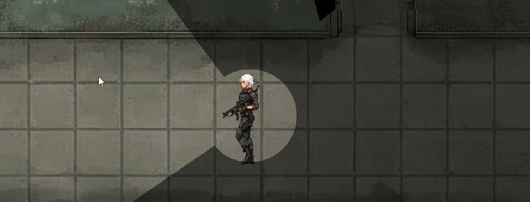
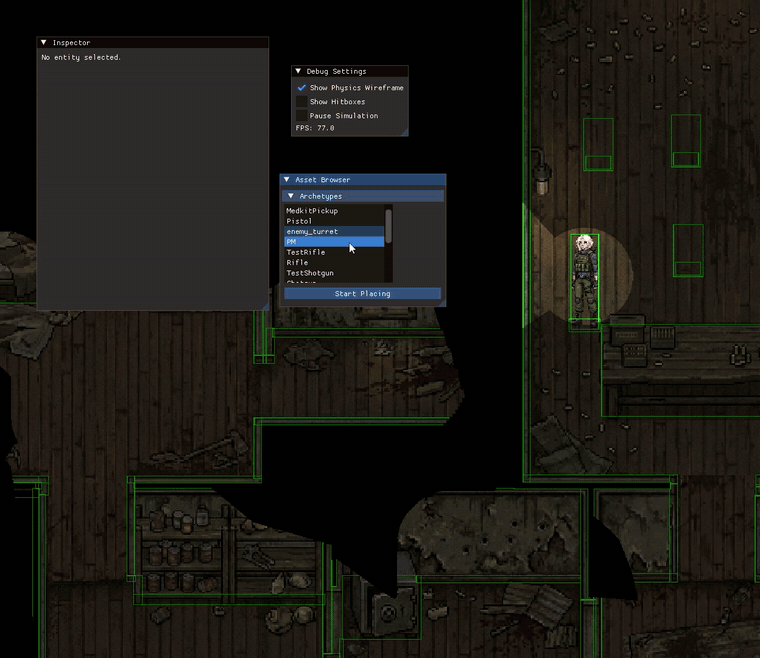
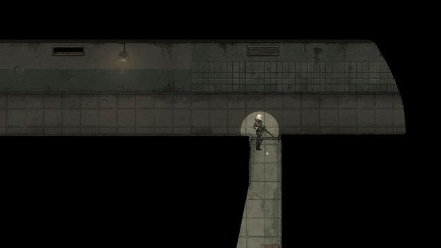
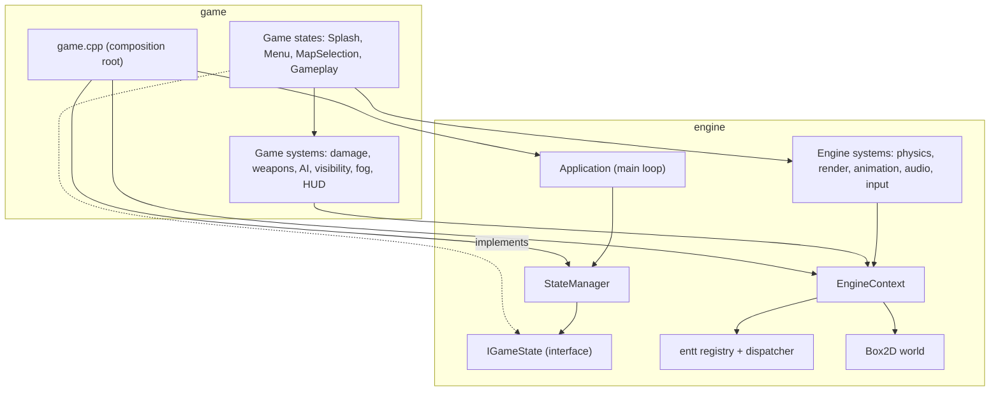

# Bajabongo Engine

A custom 2D game engine in **C++20** (EnTT ECS, Box2D 3.2, SFML 3.1), plus a proof-of-concept top-down shooter built on it.

[](LICENSE)



The repository has two layers:
- **`src/engine`**: a reusable static library with the main loop, ECS, physics, rendering, audio, input, asset loading and an in-game editor.
- **`src/game`**: a small shooter that uses the engine. It is the composition root and contains all gameplay code.

The engine is the main deliverable. The game exists to drive it and is a proof of concept, not a finished product. Its art is AI-generated and its music was made with Suno; see [assets/CREDITS.md](assets/CREDITS.md).

## Highlights

**Engine**
- **ECS on [EnTT](https://github.com/skypjack/entt).** Components are plain structs; systems receive a shared `EngineContext` (registry, dispatcher, physics world, services) via dependency injection.
- **Physics with Box2D 3.2 (C API).** Bodies are created from pending components, with transform sync, sensor events for hits and pickups, and ray and shape casts for line of sight and AI.
- **Rendering with SFML 3.1.** Sprites, a camera, clip-based animation and an animation state machine, plus a GLSL fog shader.
- **Event dispatcher.** Cross-system signals such as physics sensor contacts, sound and music requests, and state changes go through the EnTT dispatcher.
- **State stack.** A push-down automaton with deferred Push, Pop, Swap and Clear runs the game flow: splash → menu → hideout → map select → mission.
- **Audio.** A pool of 64 SFML sound sources with positional attenuation, looping weapon sounds and a music player.
- **Data-driven content.**
  - Entities are composed from `assets/data/archetypes.json`, including parent/child entity hierarchies.
  - Maps are Tiled JSON exports: image, collision and entity layers.
  - All textures, sprites, animations and sounds are declared in `resources.json`.
- **Logging.** spdlog with per-system loggers, writing to the console and to `logs/game.log`. Levels are set in `config/logging.ini`.
- **Engine/game decoupling enforced by the build.** A CMake check fails the build if anything in `src/engine` includes a `src/game` header. A `baja_header_check` target compiles every engine header on its own.

**In-game editor (F1)** with Dear ImGui:
- Entity **Hierarchy** with delete.
- **Inspector** with live editing of Transform, Renderable, Physics Body, Health, Weapon and Player. The game registers its own inspectors through a hook.
- **Asset Browser** that spawns any archetype.
- **Debug Settings**: physics wireframe, hitboxes, pause simulation.



**Gameplay systems in the proof-of-concept game**
- **Fog of war and line of sight.** A view-cone polygon is built from Box2D ray casts against wall vertices, then rendered through a fog shader. Enemies outside the player's view are hidden.
- **Weapons.** Pistol, SMG (3-round burst), rifle (full auto) and shotgun (8 pellets). Each has ammo, reload, spread, bloom and recoil, with projectiles fired from a per-shooter muzzle point.
- **Enemy AI.** Archetypes for patroller, rusher, sniper and turret, driven by a state machine (idle, patrol, alert, chase, rush, shoot, retreat and others). Detection uses line of sight.
  - There is **no pathfinding**. Enemies steer straight toward a target, slide along walls, and use a stuck-recovery system with sidestep, impulse and teleport.
- **Other.** Damage with hit flash and dead bodies, medkits, an interactable mission table, and a HUD.



## Engineering

- **Build.** CMake 3.21+ with presets for Windows (Visual Studio 2022, optional Ninja) and Linux (Ninja Debug and Release).
- **Dependencies.** vcpkg manifest mode with a pinned baseline: SFML, EnTT, Box2D, spdlog, nlohmann-json, Dear ImGui, imgui-sfml and Catch2.
- **Tests.** 133 Catch2 and CTest cases, none of which open a window. They cover:
  - pure math and logic;
  - headless ECS systems (damage, pickups, visibility, detection, weapons);
  - EntityFactory and MapLoader;
  - integration loads of both shipped maps;
  - JSON robustness;
  - a fixed-timestep headless simulation;
  - a seeded enemy-AI regression on the hospital map.
- **Sanitizers and coverage.** An ASan/UBSan preset (`linux-ninja-debug-sanitize`) and a gcov coverage preset with a summary script.
- **Static checks.**
  - Strict warnings: `-Wall -Wextra -Wshadow -Wconversion` on Linux, `/W4` on MSVC.
  - `.clang-tidy` with `tools/run-clang-tidy.sh`.
  - `.clang-format` and `.editorconfig`.
- **Tooling.**
  - `baja_bench`: a headless benchmark that runs 600 fixed-timestep frames.
  - `baja_enemy_ai_diag`: a headless AI diagnosis tool that reports stuck checks and teleports per map.
  - Deterministic runs with `--seed`.

## Architecture

The game builds `EngineContext`, wires services and hands control to the engine's `Application`. `Application` runs the loop and delegates to the active state. Gameplay states run engine systems (physics, render, animation, audio) alongside game systems (damage, visibility, weapons, AI, HUD, fog) on a fixed timestep.

For layers, the frame order, data flow and the AI, see [docs/ARCHITECTURE.md](docs/ARCHITECTURE.md).



Arrows mean "depends on / uses". All dependencies point from `game` to `engine`: the engine never includes a type from `src/game/`, and the CMake targets enforce that split.

## Building

Full instructions and troubleshooting are in [docs/BUILDING.md](docs/BUILDING.md). You need CMake 3.21+, a C++20 compiler and vcpkg, with `VCPKG_ROOT` set.

```bash
# Windows (VS 2022)
cmake --preset windows-vs2022
cmake --build --preset windows-vs2022-debug

# Linux (Ninja); tests are on by default in the Linux presets
cmake --preset linux-ninja-debug
cmake --build --preset linux-ninja-debug
ctest --test-dir build/linux-ninja-debug --output-on-failure
```

Run the game from its output folder, for example `build/linux-ninja-debug/out/game/Debug/game`, so the relative `../../assets` paths resolve.

**Assets.** Game media (`assets/textures`, `assets/sounds`, `assets/music`) is not tracked in git. It is distributed as a zip on the GitHub Releases page; unpack it into `assets/`. Data files, fonts and shaders are in the repository.

## Controls

| Action | Input |
|---|---|
| Move / run | `W` `A` `S` `D` / hold `Left Shift` |
| Aim / fire | hold right mouse button, then left mouse button |
| Reload | `R` |
| Switch weapon | `1`–`9` |
| Use medkit | `H` |
| Interact (mission table) | `E` |
| Back / previous state | `Esc` |
| Toggle in-game editor | `F1` |
| Menus | `W`/`S` or arrow keys, `Enter`/`Space`, mouse |

## Dev flags

```text
game --map hideout|hospital   # skip splash and menu, load a map directly
game --seed <n>               # seed the shared RNG; the seed is always logged
game --map hospital --seed 1  # repeatable smoke run
```

## Status and known limitations

- The game is a **proof of concept**: two playable maps (hideout and hospital) and a short loop.
- **No pathfinding.** AI uses direct steering with wall-slide and stuck recovery.
- The map loader expects the layer layout used by the shipped Tiled maps, not arbitrary Tiled files.
- Remaining TODOs and known debt are listed in [docs/TECH_DEBT.md](docs/TECH_DEBT.md). Recent changes are in [CHANGELOG.md](CHANGELOG.md).

More subsystem notes are in [docs/](docs): ECS, events, physics, rendering and animation, audio, input, logging, the asset pipeline and the state stack. Contribution rules are in [CONTRIBUTING.md](CONTRIBUTING.md).

## Credits

- Graphics are AI-generated.
- Music was made with [Suno](https://suno.com).
- Sound effects are CC0 recordings from Freesound plus ElevenLabs-generated sounds.
- The font is Bebas Neue (SIL OFL).

Details and per-file sources are in [assets/CREDITS.md](assets/CREDITS.md).

## License

Source code and documentation are released under the [MIT License](LICENSE). Files under `assets/` have their own terms, listed in [assets/CREDITS.md](assets/CREDITS.md).
