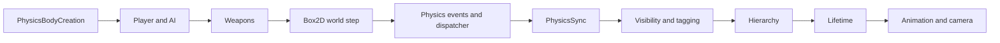
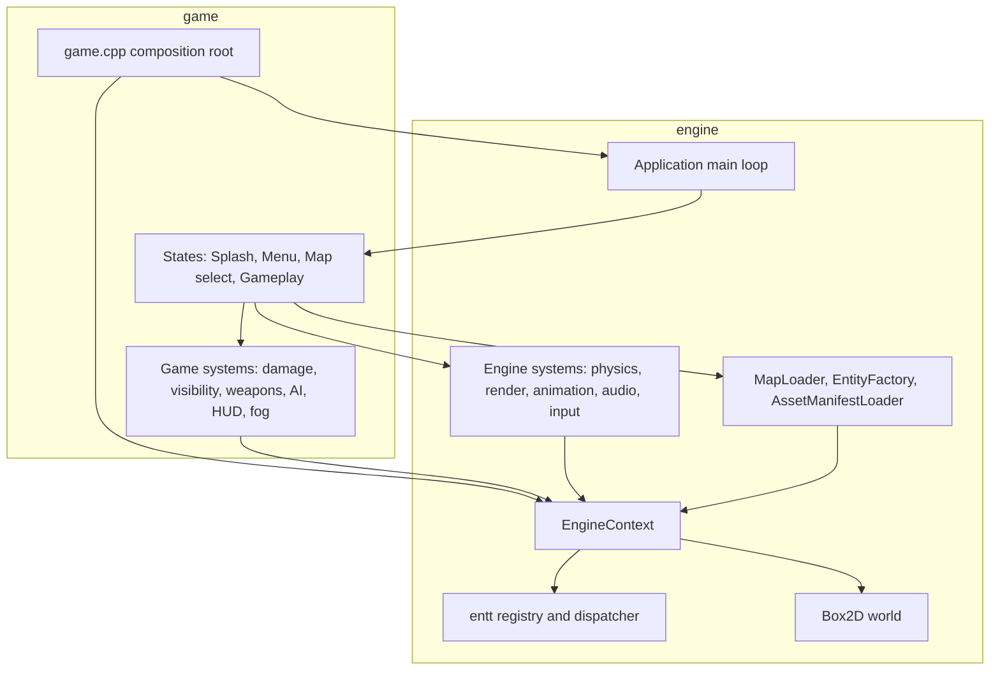

# Architecture

Bajabongo Engine is a data-driven 2D game built as two layers: a reusable `engine` static library and a `game` executable that owns the composition root and gameplay systems. Engine sources must not include headers from `src/game`. CMake enforces that on every build through `cmake/CheckEngineDecoupling.cmake`.

## Layers

- **game** (`src/game`): `game.cpp` builds `EngineContext`, wires services, and starts `Application`. Game states (splash, menu, map select, gameplay) and gameplay systems (damage, visibility, weapons, AI, HUD, fog) live here.
- **engine** (`src/engine`): window and main loop, `EngineContext`, the EnTT registry and dispatcher, Box2D, rendering, animation, audio, input, asset loaders, and shared engine systems (physics body creation and sync, lifetime, hierarchy, and the animation state machine).

Game systems talk to the engine through `EngineContext`, interfaces, hooks, and configuration. Fallback texture and font paths are supplied by the game via `EngineContext::AssetPathConfig`. The engine does not hardcode game assets such as `eg.png` or `default.ttf`.

## Runtime context

`EngineContext` is the service bag passed into systems and states. Typical members include:

- `m_registry` and `m_dispatcher` (EnTT)
- `m_physicsWorld` (Box2D world id)
- `m_logManager`, resource and sprite managers, animation library
- `m_entityFactory` and `m_archetypeManager`
- window, renderer, input, and audio when a window is present
- `mapScale` and debug flags

Headless tests construct a subset of this context (registry, dispatcher, logger, physics world) without an SFML window.

## Data and spawning

Tiled maps under `assets/data/` (`map_hideout.json`, `map_hospital.json`) are loaded by `MapLoader`. Image layers become a background entity, Collision and HalfCollision layers become pending physics bodies, and the Entities layer is spawned through `EntityFactory` using archetypes from `assets/data/archetypes.json`. `PhysicsBodyCreationSystem` turns `PendingPhysicsBodyComponent` into live Box2D bodies.

`resources.json` is loaded by `AssetManifestLoader` (textures, sprites, animation clips, sound and music paths). Invalid JSON is rejected without throwing; see the robustness tests in `tests/`.

## Frame loop (gameplay)

`GameplayState::update` runs a fixed-dt tick roughly in this order:



Render, fog, HUD, and the ImGui editor run after the simulation tick and need a window. Headless tests and `baja_bench` reuse the simulation systems only, including detection, state transitions, movement, and stuck recovery in `HeadlessGameplayLoop`.

## High-level graph



## Enemy AI

Gameplay AI lives under `src/game/ai/` and runs in the "Player and AI" step of the gameplay tick, before the Box2D world step. There is no pathfinding. Enemies walk in a straight line toward a patrol point or the player, then slide along walls and recover if they jam.

**States.** `EnemyState` covers Idle, Patrol, Alert, Approach, Chase, Rush, Shoot, Camp, Retreat, Hide, Turret, and Dead. `EnemyDetectionSystem` sets line of sight and `lastKnownPosition`. `EnemyStateTransitions` picks the next state. `EnemyMovementSystem` and `EnemyCombatSystem` apply it. `EnemyStuckRecoverySystem` watches displacement every two seconds.

**Patrol waypoints.** Archetype waypoint lists are offsets from each spawn, scaled by `mapScale`. An empty list becomes a wander box around the spawn. Absolute lists on the map object (including a Tiled `waypoints` property) still override the archetype. After `PhysicsBodyCreationSystem` flushes Collision and HalfCollision, `validateLoadedPatrolWaypoints` shape-casts the feet collider along each segment and shortens or rerolls a blocked point (or keeps the enemy in place).

**Movement and unstuck.** The wall-slide ray starts at the solid feet fixture, not the sprite origin, with a lookahead of at least 48 units. `lastValidPosition` updates only after the body actually moved. If a patrolling enemy fails two stuck checks, it skips to the next waypoint. If a Chase, Approach, or Rush is stuck for two checks, the enemy sidesteps toward the most open direction for a short time. Later checks can still impulse, teleport to a last-valid or waypoint position (not while visible; a shove is used instead), or, as a last resort, kill a permanently stuck hidden enemy.

### Headless diagnosis tool

`baja_enemy_ai_diag` is built with the tests. It loads hideout and hospital without a window, seeds `engine::Random`, and prints stuck, teleport, and displacement totals. The Catch2 hospital regression uses the same harness (seed 1, 1800 frames).

```bash
# Default: both maps, seed 1, 30 seconds (1800 frames). Assets default to BAJA_ASSETS_DIR.
./build/linux-ninja-debug/tests/baja_enemy_ai_diag

# Explicit assets, seed, and duration
./build/linux-ninja-debug/tests/baja_enemy_ai_diag /path/to/assets 1 30

# Place the player behind a wall near the first hospital enemy and prime a chase
./build/linux-ninja-debug/tests/baja_enemy_ai_diag /path/to/assets 1 30 chase
```

## Related docs

- [Building](BUILDING.md)
- [ECS](ecs.md), [Physics](physics.md), [State management](state_management.md)
- [Asset pipeline](asset_pipeline.md), [Events](events.md), [Technical debt](TECH_DEBT.md)
