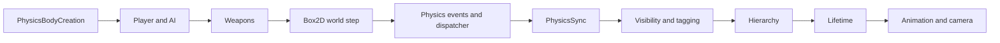
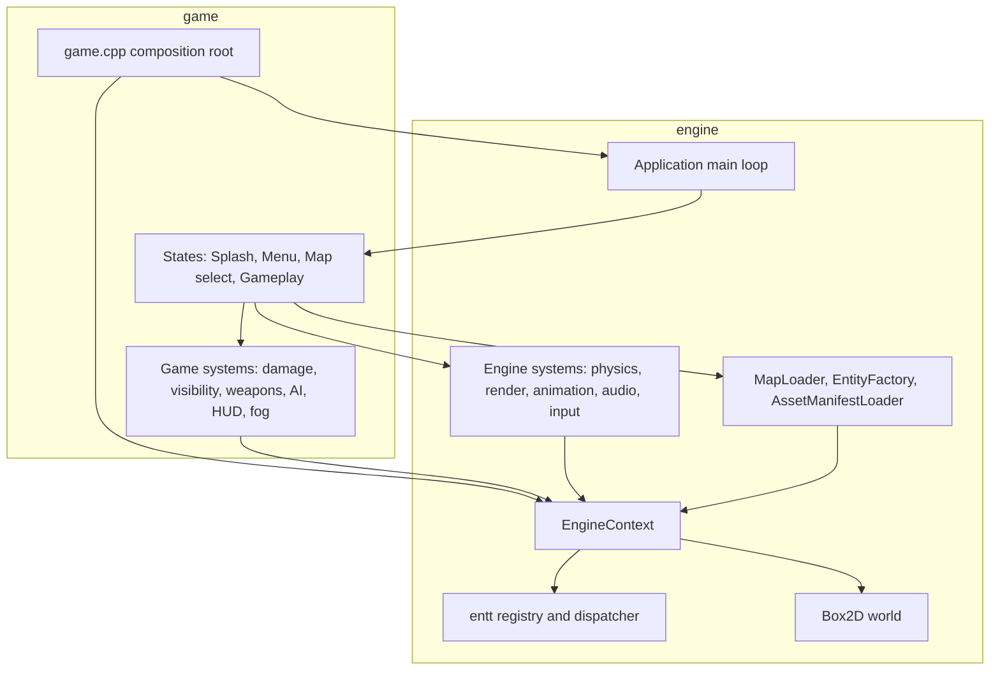

# Architecture

Bajabongo Engine is a data-driven 2D game built as two layers: a reusable `engine` static library and a `game` executable that owns the composition root and gameplay systems. Engine sources must not include headers from `src/game`. CMake enforces that on every build through `cmake/CheckEngineDecoupling.cmake`.

## Layers

- **game** (`src/game`): `game.cpp` builds `EngineContext`, wires services, and starts `Application`. Game states (splash, menu, map select, gameplay) and gameplay systems (damage, visibility, weapons, AI, HUD, fog) live here.
- **engine** (`src/engine`): window and main loop, `EngineContext`, the EnTT registry and dispatcher, Box2D, rendering, animation, audio, input, asset loaders, and shared engine systems (physics body creation and sync, lifetime, hierarchy, and the animation state machine).

Game systems talk to the engine through `EngineContext`, interfaces, hooks, and configuration. Fallback texture and font paths are supplied by the game via `EngineContext::AssetPathConfig`. The engine does not hardcode game assets such as `eg.png` or `default.ttf`.

## Runtime context

`EngineContext` is the service bag passed into systems and states. Typical members include:

- `m_registry` and `m_dispatcher` (EnTT)
- `m_physicsWorld` (Box2D world id)
- `m_logManager`, resource and sprite managers, animation library
- `m_entityFactory` and `m_archetypeManager`
- window, renderer, input, and audio when a window is present
- `mapScale` and debug flags

Headless tests construct a subset of this context (registry, dispatcher, logger, physics world) without an SFML window.

## Data and spawning

Tiled maps under `assets/data/` (`map_hideout.json`, `map_hospital.json`) are loaded by `MapLoader`. Image layers become a background entity, Collision and HalfCollision layers become pending physics bodies, and the Entities layer is spawned through `EntityFactory` using archetypes from `assets/data/archetypes.json`. `PhysicsBodyCreationSystem` turns `PendingPhysicsBodyComponent` into live Box2D bodies.

`resources.json` is loaded by `AssetManifestLoader` (textures, sprites, animation clips, sound and music paths). Invalid JSON is rejected without throwing; see the robustness tests in `tests/`.

## Frame loop (gameplay)

`GameplayState::update` runs a fixed-dt tick roughly in this order:

Render, fog, HUD, and the ImGui editor run after the simulation tick and need a window. Headless tests and `baja_bench` reuse the simulation systems only.

## High-level graph

## Related docs

- [Building](BUILDING.md)
- [ECS](ecs.md), [Physics](physics.md), [State management](state_management.md)
- [Asset pipeline](asset_pipeline.md), [Events](events.md), [Technical debt](TECH_DEBT.md)
